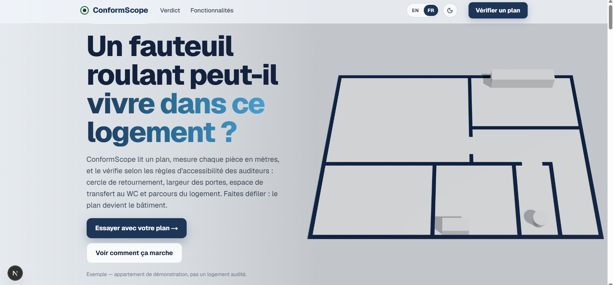
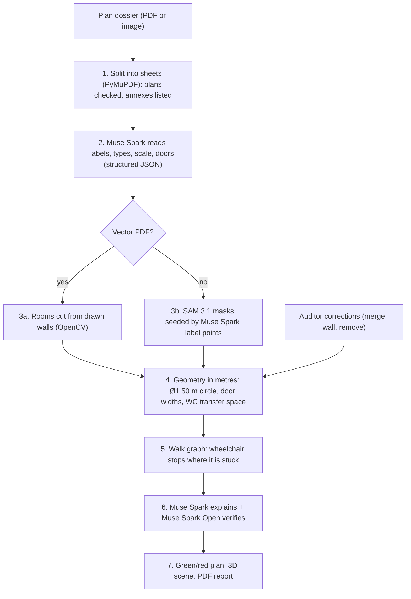

# ConformScope

> **Can a wheelchair live in this home? Drop a building plan and find out, while the fix still costs an eraser instead of a renovation.**



## 📺 Demo

Demo video: [`docs/media/demo.mp4`](docs/media/demo.mp4)

[](LICENSE)
[](https://www.python.org/)
[](https://fastapi.tiangolo.com/)
[](https://nextjs.org/)
[](https://dev.meta.ai/)
[](tests/)

---

## 🏆 Built During the Hackathon

**ConformScope was built during the Meta Global AI Developer Hackathon (October 27 – November 4, 2026)**, **Indie Developer** track, theme **Build for Your World**.

- Roadmap and slice plan: [ROADMAP.md](ROADMAP.md)
- Official submission portal: <https://cerebralvalley.ai/e/meta-ai-developer-hackathon/hackathon/submit>

---

## 💡 Overview

Homes get approved on paper. People in wheelchairs often find out a home doesn't work for them only after they move in. Today an engineer checks each plan by hand, room by room with a ruler, and a tired reviewer can miss things.

**ConformScope** reads a building plan, finds every room, door and toilet, and checks them against French accessibility (**PMR**) rules using real geometry:

1. **Upload a dossier.** One PDF becomes one dossier, with one sheet per page. Annex sheets (masse, situation, toiture, combles) are listed but not checked. Each sheet is checked when you open it, and the stages stream live to a progress bar.
2. **Read the plan.** **Muse Spark** reads room names, room types, the scale and the door symbols. **SAM 3.1** outlines rooms on scanned or photographed plans. On vector PDFs, rooms come straight from the drawn walls.
3. **Measure.** Every room becomes a polygon in metres and gets checked:
   - **Turning circle:** the largest free circle in the room must reach **Ø 1.50 m**. The plan shows it green or red.
   - **Doors:** each swing arc gives a nominal width. Interior doors need **0.80 m** and the entrance needs **0.90 m**.
   - **Toilets:** a **0.80 × 1.30 m** transfer space beside the WC, plus space at the washbasin.
4. **Walk the plan.** Rooms and doors form a graph. A virtual wheelchair moves through the home and stops where a real person would get stuck.
5. **Explain and verify.** For each failure, Muse Spark writes a plain-language reason and a fix. **Muse Spark Open** (on Baseten) checks every verdict again and flags the doubtful ones.
6. **Correct and export.** An auditor can fix the room layout by clicking: merge a nook into a room, draw a missing wall, or remove a fixture or door. Each correction is saved with the plan and applied again on every re-measure. One click exports a **PDF report**.

The web app works in **English and French**, has light and dark themes, and includes a 3D scene where the plan rises into a building.

---

## 🤖 How Meta's Models Are Used

**The models read and explain. The geometry decides.** No model output sets a verdict on its own.

| Model | Role | Details |
| --- | --- | --- |
| **`muse-spark-1.3`** (Meta Model API) | **Plan reading** | Reads room labels, types, written areas, scale and door symbols, with their positions on the image. Output is schema-constrained JSON (`json_schema`). |
| **`sam-3.1`** (Meta Model API) | **Room & fixture segmentation** | Segments rooms on picture plans (scans and photos), prompted with the label points Muse Spark found. Refines fixture boxes on picture plans. Masks are decoded with `meta-sam-parser`. |
| **`muse-spark-1.3`** | **Explanations** | Turns each measured failure into a plain-language reason and a fix. |
| **Muse Spark Open** (Baseten) | **Verifier agent** | Checks each verdict again through tool calls and flags the doubtful ones for the auditor. |
| **Muse Code** on **Muse Wonder** (`muse-wonder-1.0`) | **Coding agent** | Helped build the project, and is credited as co-author in the merge commits on `main`. |

Auditor corrections can be exported as JSONL fine-tune labels in Fireworks format (`/labels` endpoint).

---

## 🏗️ System Architecture



- **Backend:** FastAPI (Python 3.12, `uv`), in `src/conformscope/`. Model keys stay on the server.
- **Frontend:** Next.js 16 + React 19 + three.js, in `web/`. The browser only talks to `/api/*`.
- **Deploy:** one Vercel project with two services, configured in [`vercel.json`](vercel.json).

---

## 📐 The Rules Being Checked

| Check | Requirement | How it is measured |
| --- | --- | --- |
| Turning circle | Ø 1.50 m free circle per room | Largest inscribed circle in the room polygon (`turning.py`) |
| Interior door | ≥ 0.80 m nominal width | Radius of the door's swing arc (`doors.py`) |
| Entrance door | ≥ 0.90 m nominal width | Same as above |
| WC transfer space | 0.80 × 1.30 m beside the toilet | Free rectangle beside the fixture (`fixtures.py`) |
| Washbasin space | 0.80 × 1.30 m in front | Free rectangle at the fixture |
| Route through the home | Every room reachable | Room and door graph walk (`walk.py`) |

---

## 🚀 Getting Started

### Prerequisites

- Python 3.12+ and [uv](https://docs.astral.sh/uv/)
- Node.js 20+
- A Meta Model API key from [dev.meta.ai](https://dev.meta.ai/)

### 1. Clone & install

```bash
git clone https://github.com/Azizomezine/ConformScope.git
cd ConformScope
uv sync
```

### 2. Configure environment variables

```bash
# macOS / Linux / Git Bash
cp .env.example .env

# Windows PowerShell
Copy-Item .env.example .env
```

```env
MODEL_API_KEY=      # Meta Model API (Muse Spark, SAM 3.1), required
BASETEN_API_KEY=    # Muse Spark Open verifier, optional
FIREWORKS_API_KEY=  # fine-tune labels, optional
META_API_KEY=       # used by Muse Code only
```

### 3. Run the backend

```bash
uv run uvicorn conformscope.api:app --reload   # http://127.0.0.1:8000
```

### 4. Run the frontend (second terminal)

```bash
cd web
npm install
npm run dev                                     # http://localhost:3000
```

Open <http://localhost:3000>, click **Vérifier un plan / Check a plan**, and drop in a PDF or image. You will see the rooms outlined with their areas, each turning circle in green (*Conforme PMR*) or red (*Non conforme PMR (max Ø…)*), and the verdict list beside the plan.

### 5. Try the corrections

1. Upload a vector PDF plan.
2. Click **Merge a nook into a room**. Click the room that stays, then the nook. The room is measured again and marked *corrected by hand*.
3. Click **Draw a missing wall** and click two points across an opening. The rooms on each side are cut again.
4. Reload the page. Corrections are stored per plan (`corrections.json`) and applied again on every re-measure.
5. **Clear corrections** removes them all.

### 6. Run the tests

```bash
uv run pytest          # 235 tests
cd web && npm run build
```

- Unit tests use fixed synthetic inputs. They make no network or model calls and need no private plans.
- The sample-plan tests (`Plan_Logement_Niveau_02`) run only when `samples/private/Plan_Logement_Niveau_02.pdf` exists, and skip cleanly without it.

---

## 🔌 API

| Endpoint | What it does |
| --- | --- |
| `POST /plans` | Upload a dossier (one PDF, one sheet per page) and list its sheets |
| `GET /plans/{id}` | The dossier and its sheets |
| `GET /plans/{id}/sheets/{page}` | Check a sheet (stages stream as NDJSON), then store the result |
| `GET /plans/{id}/sheets/{page}/image` | The rendered sheet |
| `GET /plans/{id}/sheets/{page}/walk` | Walk the stored sheet again, from any room |
| `GET /plans/{id}/sheets/{page}/explain` | Reason and fix for each failure (Muse Spark), checked by Muse Spark Open |
| `GET /plans/{id}/sheets/{page}/corrections` | Stored corrections for the sheet |
| `POST /plans/{id}/sheets/{page}/corrections` | Replace the corrections, then measure again and apply them |
| `GET /plans/{id}/sheets/{page}/labels` | The sheet's corrections as JSONL fine-tune labels (Fireworks format) |
| `GET /plans/{id}/report.pdf` | The dossier report as a PDF |

---

## 🧪 Validation Status

Tested on a real apartment plan (`Plan_Logement_Niveau_02`, kept private and git-ignored):

- **6 of 8** written room areas land within **5%** of the area ConformScope measures.
- The two misses are rooms where the drawing is ambiguous, which is the case the auditor corrections are for.
- **235** automated tests cover geometry, doors, fixtures, the walk, corrections, report and API.

---

## 🤝 Development Transparency

Built during the hackathon window by **Omezine Mohamed Aziz** ([@Azizomezine](https://github.com/Azizomezine)), with the **Muse Code** coding agent on Muse Wonder. The author directed the work and reviewed, tested and iterated on the code. At runtime, Meta's models do the plan reading, segmentation, explanations and verification. The pass/fail decisions are deterministic geometry.

---

## ⚠️ Limitations & Honesty Notes

- **Rules are a subset.** ConformScope checks the turning circle, door widths, WC/washbasin space and the route through the home. It does not replace a full PMR audit.
- **Merge can overshoot.** On the sample plan, merging the whole landing into the 10.09 m² bedroom gives +12.4% (the target is 5%), because the cupboard is a sub-region. Draw a wall to isolate the cupboard first, then merge.
- **Verdict vs. drawn circle.** The verdict uses the bare room polygon. The drawn circle avoids obstacles. In cluttered rooms the two can disagree. The bare-room rule is intentional.
- **Picture plans.** Corrections apply to vector PDFs. Plans submitted as pictures ignore them for now.
- **Homes on one sheet.** Splitting a sheet into separate apartments is not supported yet.

---

## 📄 License & Credits

Licensed under the [Apache License 2.0](LICENSE).

Room reading by **Muse Spark**, segmentation by **SAM 3.1** (Meta Model API), and verification by **Muse Spark Open** on Baseten.
